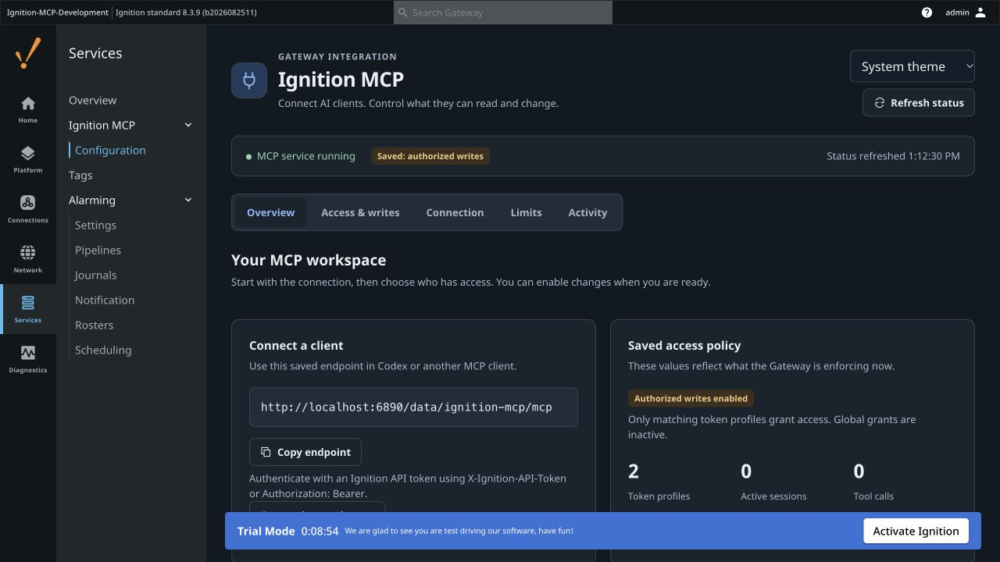

# Ignition MCP

Ignition MCP connects AI clients to an Ignition 8.3 Gateway. The optional Designer Assistant adds a chat dock to Ignition Designer 8.3.9 or later 8.3.x releases and uses the Gateway module for authorized project tools.

| Module | Install it for |
|---|---|
| **Ignition MCP** (`ignition-mcp.modl`) | Connecting an external MCP client to the Gateway using a scoped Ignition API key. [Gateway setup](docs/USER_GUIDE.md) |
| **Designer Assistant** (`ignition-designer-assistant.modl`) | Asking about the open project and reviewing or applying changes from a dock in Designer. Uses your Designer login for Gateway tools and a model provider configured on your workstation. Install both modules for this setup. [Designer setup](docs/DESIGNER_ASSISTANT.md) |

Download signed modules and SHA-256 checksums from [GitHub Releases](https://github.com/JonathanGrocott/ignition-mcp/releases). The [0.5.1 prerelease](https://github.com/JonathanGrocott/ignition-mcp/releases/tag/v0.5.1) includes Ignition MCP **0.5.1** and Designer Assistant **0.4.7**. See the [Designer install guide](docs/DESIGNER_ASSISTANT.md#download-and-install) for the compatible pair and setup.



## What it can do

Ignition MCP **0.5.0** exposes **43 tools**:

- Browse/read tags, inspect definitions and UDTs, search OPC mappings and collect bounded snapshots.
- Inspect Perspective views, stored bindings/events, project resources and literal source references.
- Read Gateway status, installed modules, connection status and bounded logs.
- Inspect named queries, query tag history and list alarms, subject to permissions.
- Import and update Perspective views and other Designer project resources from native Ignition export ZIPs or portable JSON bundles. Use preview/apply or opt in to direct writes. Both workflows check for conflicts and verify saved resources.
- Perform scoped legacy tag, definition, script, named-query and alarm operations where supported.

See the complete [Tool Reference](docs/TOOL_REFERENCE.md) for names, access classes and limitations. There is no arbitrary Gateway script execution tool. This is a tools-only MCP server; it does not expose MCP resources/prompts. The Gateway UI configures access and displays activity; change previews are returned to the MCP client.

## Quick start for external MCP clients

1. Install the **signed** `ignition-mcp.modl` through **Platform → System → Modules** on an Ignition 8.3 development Gateway.
2. Create an API key under **Platform → Security → API Keys**.
3. Open **Services → Ignition MCP → Configuration**. Under **Access & writes**, start with **Read-only**, choose **Profiles only**, and add a reader profile matching the token name and intended tag/project paths. Click **Save changes**.
4. Copy the endpoint from **Overview** or **Connection** and configure your [Codex or Claude Code client](docs/CLAUDE_CODEX_SETUP.md).
5. Make a scoped read call. For writes, follow the [write-access and preview workflow](docs/USER_GUIDE.md#6-allow-writes).

The default endpoint is `http://localhost:8088/data/ignition-mcp/mcp`; use your actual Gateway host, port, HTTPS configuration and saved alias.

**Upgrade behavior:** `writesEnabled` defaults to **false**, including older persisted configurations missing that field. An operator must explicitly allow writes before a committing MCP call can succeed. Global and profile grants combine in the compatibility-default `additive` mode; `profiles-only` ignores all global grants. Full access grants all MCP tools and targets to matching tokens. Direct project changes are disabled until enabled by a Gateway administrator. See [migration and change semantics](docs/CHANGE_WORKFLOWS.md).

## Documentation

| Guide | Audience / purpose |
|---|---|
| [User Guide](docs/USER_GUIDE.md) | Illustrated installation, first read, scoped permissions, writes and troubleshooting |
| [Designer Assistant](docs/DESIGNER_ASSISTANT.md) | Install the companion module, grant Designer access, choose a model, and review changes |
| [Gateway UI](docs/GATEWAY_UI.md) | Section-by-section UI, visual profiles, themes, drafts and save behavior |
| [External MCP Client Setup](docs/CLAUDE_CODEX_SETUP.md) | Codex desktop/CLI and Claude Code configuration for the Gateway MCP endpoint |
| [Tool Reference](docs/TOOL_REFERENCE.md) | Tool names, required grants and supported write surfaces |
| [Change Workflows](docs/CHANGE_WORKFLOWS.md) | Bundle format, preview/apply contracts, expiry, conflicts and uncertain outcomes |
| [Inspection Tools](docs/INSPECTION_TOOLS.md) | Detailed inspection arguments, work budgets, partial results and unsupported formats |
| [MCP Protocol Examples](docs/MCP_REFERENCE.md) | HTTP routes, session headers and JSON-RPC examples |
| [Local Gateway Testing](docs/LOCAL_GATEWAY_TESTING.md) | Developer setup and repeatable tests; distinguish read-only from committing runners |
| [Manual Acceptance Workflow](docs/DEVELOPMENT_TEST_WORKFLOW.md) | Portable synthetic fixture setup and manual Designer acceptance steps |
| [Validation evidence](docs/VALIDATION.md) | Automated/live results and qualification limits for the release features |
| [Publishing signed modules](docs/RELEASING.md) | Branch artifacts, release signing, compatible asset pairs, and verification |

## Build from source

The Designer resource write features described here require **0.5.0**.

End users installing a built module do not need the build toolchain. Developers need Java 17 and access to the Ignition Maven repositories:

```bash
./gradlew test zipModule checksumModl
node --test gateway/src/test/js/mcp-admin.test.cjs
./scripts/sign-module.sh
```

Outputs:

- Signed installable module: `build/ignition-mcp.modl`
- Unsigned intermediate: `build/ignition-mcp.unsigned.modl`
- Packaging/checksum metadata: `build/checksum/checksum.json`

`checksumModl` verifies that the packaged common/Gateway JARs match the current build outputs. Signing uses the existing local signing material; the helper creates a self-signed development certificate when none is present. Keep private signing material out of source control. See [certificate guidance](certs/README.md).

Branch CI produces development-signed artifacts for both modules. See the [release guide](docs/RELEASING.md) for publishing a tested pair under the release signing identity.

## Supported and unverified boundaries

Both modules require Ignition 8.3.9 or later 8.3.x. They compile against the 8.3.9 SDK, and CI also compiles and tests them against 8.3.10 and the newest published 8.3.x SDK. Selected native integrations and the UI were exercised on Gateway 8.3.9. All 42 tools passed local fixture acceptance against the final signed 0.4.0 artifact, including native binary pipeline configuration readback. These results do not qualify every Ignition patch, custom pipeline body codec, production workload or browser. Reference search is literal rather than a complete dependency resolver, and source readback verifies saved content rather than Python execution or notification delivery. See the validation summary and [changelog](CHANGELOG.md).
