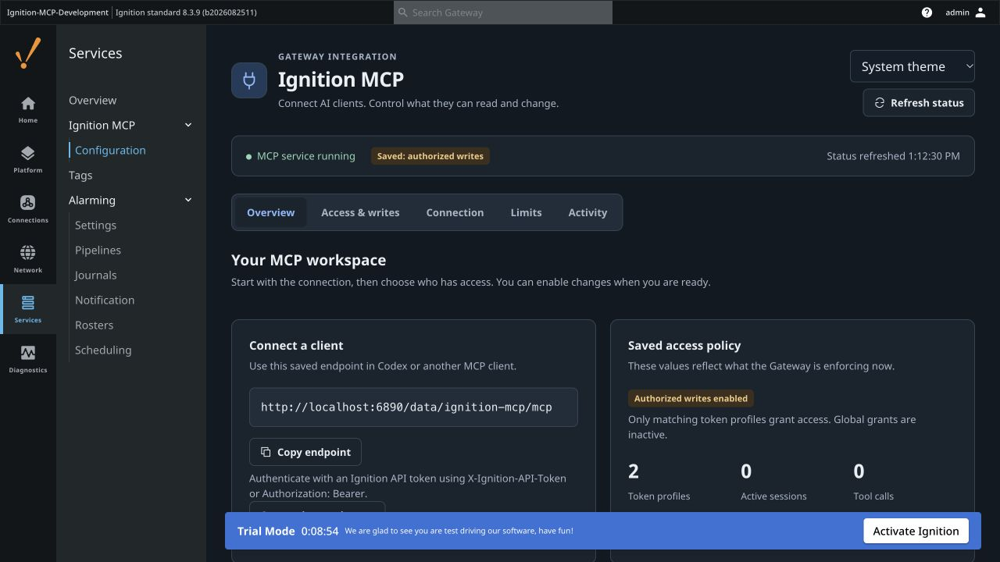
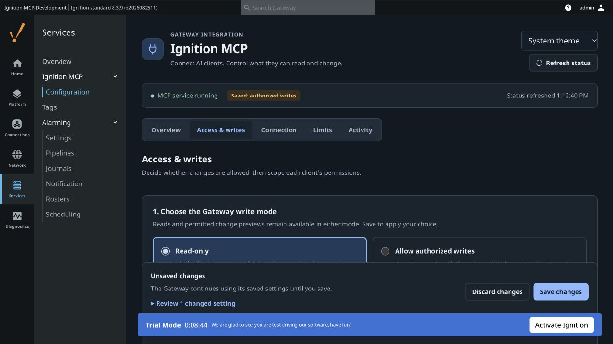
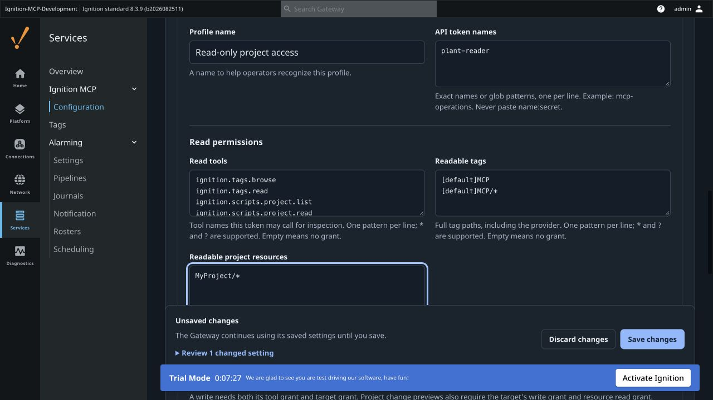

# Gateway MCP interface

For **Ignition MCP 0.4.0**. Screenshots show the interface prepared for this release; [capture notes](images/gateway/README.md) identify the pre-release build used.

Open **Services → Ignition MCP → Configuration**. The module uses the existing Gateway web session and its corresponding configuration read/write permissions. For installation, API keys and a complete first-read/change workflow, use the [illustrated User Guide](USER_GUIDE.md).

## Find a setting

| Section | Use it for |
|---|---|
| Overview | Saved service/write status, client endpoint, profile/session counts and a short setup guide |
| Access & writes | Gateway write mode, authorization mode and token profiles |
| Connection | Endpoint copy, a link to Gateway API Keys, service/transports and advanced host/origin restrictions |
| Limits | Session/request/write limits, batch sizes and query/historian row limits |
| Activity | Current sessions, call outcomes, tool latency and recent write/tool events |

The **Appearance** selector provides System, Light and Dark themes. System follows the device color scheme. Appearance is saved in this browser; it does not change the Gateway's global theme or MCP permissions. The layout adapts to a narrow panel as well as a desktop window.



*The screenshots use a synthetic Ignition 8.3.9 development Gateway. Its saved write mode is already enabled; new installations default to committed writes disabled.*

## Allow changes

1. Under **Access & writes**, select **Allow authorized writes**.
2. Give the caller a matching token profile with both its **write tool** and its **write target**. Planned Python-library changes need `ignition.projects.changes.apply`, an authorized project-resource read path, and a script write target such as `MyProject/library/MCP/*`.
3. Keep **Require explicit commit for legacy write tools** enabled for dry-runs by default. Planned apply always requires `commit: true`.
4. Review the unsaved change summary and click **Save changes**.

The status strip always shows the **saved** write mode. Choosing a different radio option edits a draft. The save bar remains available while a draft exists; **Discard changes** returns to the latest saved settings. Selecting **Read-only** and saving blocks subsequent MCP commits, while authorized reads and previews remain available. An SDK write already submitted is not cancelled.



*The save bar distinguishes draft settings from the Gateway's enforced configuration.*

## Edit profiles

The visual editor exposes profile names, API token name patterns, read/write tool patterns and tag/project/query scopes. Enter the **token name**, never its secret. Comma-separated values and one pattern per line are supported. Empty grant lists grant no access. Query execution and alarm acknowledgment targets are in their own expandable section.

**Add reader** and **Add writer** append a new profile without replacing existing ones. New profiles need token names and target scopes before they are useful. The writer template starts with the planned-apply tool, with empty write targets. API tokens themselves are created in **Platform → Security → API Keys**, not by this editor.

**Profiles only** ignores global grants and denies unmatched token names. Multiple matching profiles combine their grants. **Global + profile grants** is additive: a narrow profile cannot restrict a broad global grant. Global fields are displayed as inactive/disabled in Profiles only mode and retained for a future mode change.

**Edit JSON** remains available for advanced use. It operates on the same draft as the visual editor. Invalid JSON, malformed grant lists and pasted `name:secret` token values cannot be saved. The visual editor preserves unedited profile data, including fields it does not display; server-side configuration validation remains authoritative.



*This example profile was discarded after capture. No token secrets belong in a profile.*

## Refresh and concurrent edits

Refreshing status does not discard configuration edits. A response that started before an edit or save cannot replace the newer draft/saved state. If the UI observes a different saved configuration while a draft is open, it blocks saving over that configuration and offers **Reload saved settings**. This is a client-side check based on status polling, not an atomic server-side edit lock.

## Screenshot examples

The [User Guide](USER_GUIDE.md) also shows Connection, Limits, populated Activity and Light theme. [Capture notes](images/gateway/README.md) record the fixture and draft states.

## Validation

The [validation summary](VALIDATION.md) records the automated and native Gateway/browser checks, tested build versions and remaining qualification limits.

Repeat the UI-state tests with:

```bash
node --test gateway/src/test/js/mcp-admin.test.cjs
```
