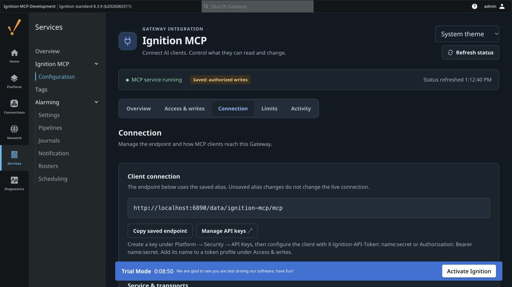
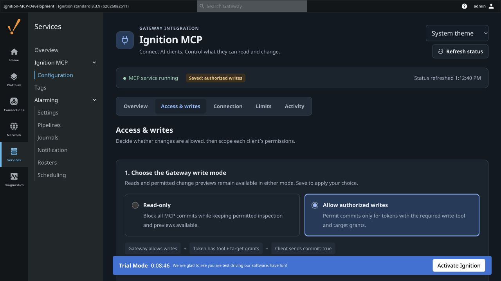
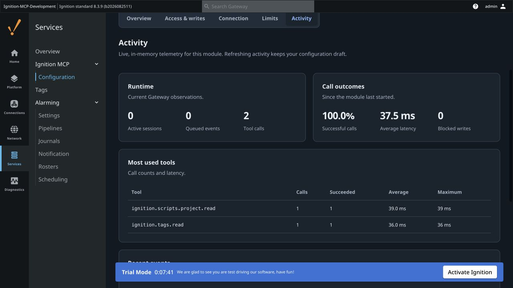
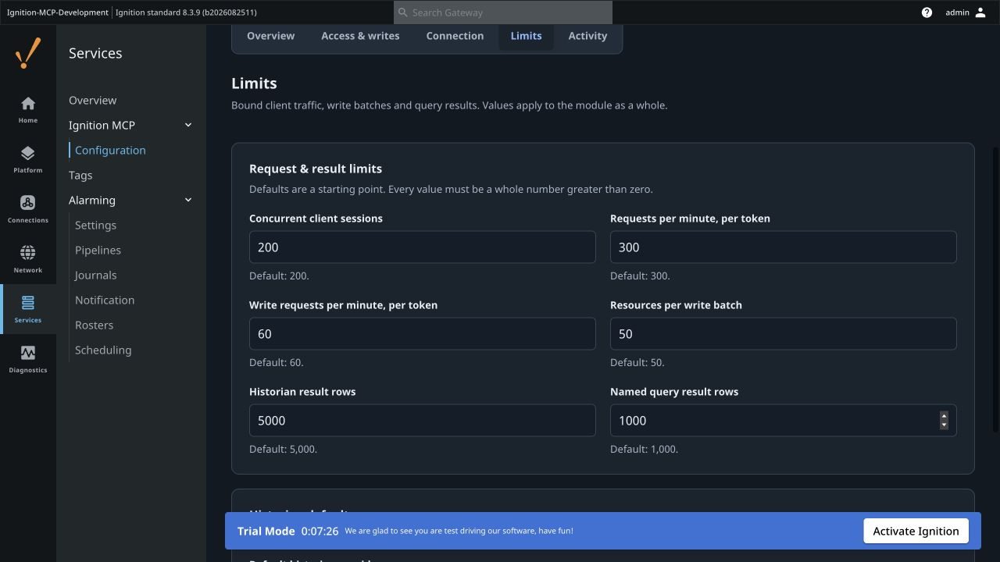
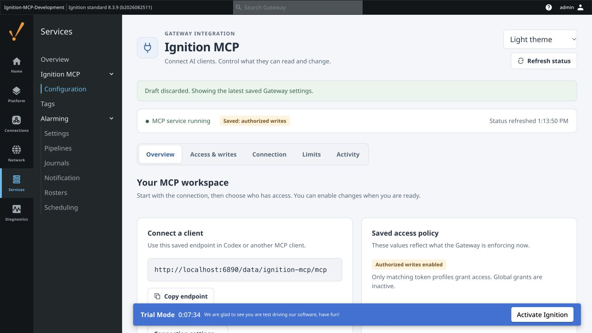

# Ignition MCP User Guide

Use this guide to connect an MCP client to Ignition, give it scoped read access, and deliberately enable supported changes.

This guide covers **Ignition MCP 0.4.0**, with **42 tools** and the redesigned Gateway UI. Install the signed **0.4.0 release module**. Screenshots show the interface prepared for this release, captured on Ignition **8.3.9** using a synthetic development project on port **6890**. See [capture notes](images/gateway/README.md) for the build used. Your Gateway name, port, resources and saved permissions will differ. Some images intentionally show **unsaved drafts**. New installations and older configurations missing `writesEnabled` start with committed writes disabled.

## Contents

1. [Install the module](#1-install-the-module)
2. [Create an API key](#2-create-an-api-key)
3. [Give a client read access](#3-give-a-client-read-access)
4. [Connect the MCP client](#4-connect-the-mcp-client)
5. [Make your first reads](#5-make-your-first-reads)
6. [Allow writes](#6-allow-writes)
7. [Preview, apply and verify a project change](#7-preview-apply-and-verify-a-project-change)
8. [Monitor activity and adjust limits](#8-monitor-activity-and-adjust-limits)
9. [Troubleshoot](#9-troubleshoot)
10. [Understand the limits](#10-understand-the-limits)

## 1. Install the module

You need an Ignition 8.3 Gateway, a matching signed module build, and a Gateway account permitted to install modules and edit settings. Start on a development Gateway with representative test resources.

1. Open **Platform → System → Modules** in the Gateway.
2. Use the module installation/upgrade action and select **`ignition-mcp.modl`**. The `.unsigned.modl` file is a build intermediate; prefer the signed artifact.
3. Review Ignition's certificate/license prompts for that build and confirm that **Ignition MCP** is running. A self-signed development certificate requires your deliberate acceptance in Ignition.
4. Open **Services → Ignition MCP → Configuration**.

An existing installation may briefly interrupt MCP connections during an upgrade. Follow Ignition's install/upgrade instructions for the target patch; a manual service restart or editing the installation directory is not the normal first step.


*Overview shows the saved endpoint and saved write mode. This development fixture already has authorized writes enabled; that is not the installation default.*

The navigation separates **Overview**, **Access & writes**, **Connection**, **Limits**, and **Activity**. Use **Appearance** for System, Light or Dark. This preference stays in your browser and does not change Gateway permissions or the Gateway's global theme.

## 2. Create an API key

Open **Platform → Security → API Keys**. The **Manage API keys** link in the MCP Connection section opens that page in a separate tab.

Create a key for the intended client, using the security settings required by your Gateway. This module authenticates through Ignition's API-token service; Ignition's own key requirements still apply. For example, a key requiring a secure channel must be used through HTTPS. Do not weaken a production key just to make an HTTP example work.

The full credential is normally supplied as **`token-name:secret`**:

| Place | Value to enter |
|---|---|
| MCP client authentication header | Full `token-name:secret` value |
| MCP profile **API token names** | Name only, such as `plant-reader` |
| Gateway browser login | Your Gateway web account, not the API token |

The module accepts either `X-Ignition-API-Token: token-name:secret` or `Authorization: Bearer token-name:secret`. Do not put the credential in the URL, screenshots or a source-controlled config file. The module does not provide an OAuth login flow; logging into the Gateway browser does not authenticate a separate MCP client.



*Copy the saved endpoint into your client. This fixture uses port 6890; the common default Gateway HTTP port is 8088.*

## 3. Give a client read access

Under **Access & writes**:

1. Select **Read-only** for the Gateway write mode.
2. Select **Profiles only — scoped access**.
3. Click **Add reader**. Enter a useful profile name and the API token's name, for example `plant-reader`.
4. Choose read tools and the tag/project paths they may access.
5. Review the draft and click **Save changes**.

Adding a profile appends it; it does not replace existing profiles or change the saved write mode. The template starts with empty token names and target scopes, so finish its configuration. You can keep the template's scoped inspection tools or reduce them to the tools you need.

For a simple client that reads tags and native Python source, use these values:

| Profile field | Example |
|---|---|
| API token names | `plant-reader` |
| Read tools | `ignition.tags.browse`, `ignition.tags.read`, `ignition.scripts.project.list`, `ignition.scripts.project.read` |
| Readable tags | `[default]MCP` and `[default]MCP/*` |
| Readable project resources | `MyProject/*` |
| Write tools and write/execute/acknowledgment targets | Empty |


*The screenshot shows a reader-profile draft. Enter the token name, never its secret. Readable tags and project resources are separate scopes.*

### How patterns work

Patterns are case-sensitive globs, using `*` and `?`. Enter one per line or separate them with commas. Empty grant lists grant no access.

| Scope | Pattern format | Example |
|---|---|---|
| Tools | Full tool name or glob | `ignition.tags.read` |
| Tags | Provider and tag path | `[default]MCP/*` |
| Project resources | `project/module/type/path` | `MyProject/ignition/script-python/MCP/*` |
| Project script writes | `project/script-type/path` | `MyProject/library/MCP/*` |
| Named query writes/execution | `project/query-path` | `MyProject/MCP/*` |

`MyProject/*` covers resources under that project. It does not grant access to other projects. Native Python libraries are read with `scriptType: "python"`, while their write-policy target uses **`library`**.

A grant for `[default]MCP/*` covers descendants, not the browse root `[default]MCP` itself. Authorize the root too when a client needs to traverse it. A parent grant does not implicitly authorize every child; configure the root and required descendants deliberately.

### Profiles only versus additive grants

- **Profiles only:** all global grants are ignored. Unmatched token names have no tool-call grants. Global fields remain visible as inactive/disabled.
- **Global + profile grants:** globals and every matching profile combine permissions. A global `*` can grant access even if one profile is narrower.

Multiple matching profiles combine their grants in both modes. A profile with no write grants does not revoke write grants from another matching profile. Use exact token names when overlapping patterns would be confusing.

The compatibility defaults include broad global read/tool grants and additive authorization. **Read-only blocks commits; it does not restrict reads to one profile.** Save Profiles only and the intended scopes before distributing a client credential.

Authentication, successful initialization and seeing the tool catalog do not themselves grant permission to call a tool.

## 4. Connect the MCP client

Copy the endpoint from **Overview** or **Connection**. With the default alias, the URL is:

```text
https://your-gateway.example/data/ignition-mcp/mcp
```

For local development it may be `http://localhost:8088/data/ignition-mcp/mcp`. Use the **client machine's** reachable Gateway address: `localhost` on a different computer refers to that computer. If the client runs remotely or in the cloud, verify network reachability from that runtime.

Use the [Codex and Claude Code setup guide](CLAUDE_CODEX_SETUP.md) for copyable configuration. Streamable HTTP is the primary transport. The optional SSE fallback is for older compatible clients; there is no separate MCP port.

After configuration, reload/reconnect the server in the client and make an actual read call. A server shown in a settings list may still be missing from the active chat's tool catalog. Gateway permission changes are checked on subsequent calls; they do not require restarting the Codex app. See [client reload guidance](CLAUDE_CODEX_SETUP.md#reload-without-interrupting-other-chats).

## 5. Make your first reads

Use your real project and tag paths in place of these examples. The module does not create these resources when installed.

Example prompt:

> Use ignition-mcp. Read [default]MCP/Speed and report its value, quality and timestamp. Read native Python library MCP/Demo in MyProject. Do not write anything.

The underlying calls are:

```json
{"name":"ignition.tags.read","arguments":{"paths":["[default]MCP/Speed"]}}
```

```json
{"name":"ignition.scripts.project.read","arguments":{"project":"MyProject","scriptType":"python","path":"MCP/Demo"}}
```

Inspect a Perspective view:

```json
{"name":"ignition.perspective.views.read","arguments":{"project":"MyProject","path":"Inspection/Main","includeScripts":false}}
```

These are MCP tool-call parameters, not complete HTTP requests. Clients normally handle JSON-RPC and session headers; see [protocol examples](MCP_REFERENCE.md) for direct requests.

Check quality and result metadata, not just values or counts. `truncated`, `complete: false`, skipped content or an unsupported format means the answer has limits. Stored source inspection does not execute scripts, render a Designer view, run SQL or contact every referenced dependency.

## 6. Allow writes

Three controls work together:

1. **Gateway operator:** select **Allow authorized writes** and save.
2. **API token profile:** grant the write tool and the permitted targets. Resource read grants are also required for planned project changes.
3. **Client call:** explicitly commit the intended operation. Keep **Require explicit commit for legacy write tools** enabled so legacy write calls default to dry-runs. Planned apply always requires `commit: true`.



*Allowing writes opens the operator gate. The token's tool and target grants still decide what it may change.*

To add planned Python-library edits to a writer profile:

| Profile field | Grant to include |
|---|---|
| Read tools | `ignition.projects.resource.read`, `ignition.scripts.project.read`, `ignition.projects.changes.preview`, `ignition.projects.changes.status` |
| Readable project resources | `MyProject/ignition/script-python/MCP/*` |
| Write tools | `ignition.projects.changes.apply` |
| Project script write targets | `MyProject/library/MCP/*` |

Add other inspection tools or target scopes only as needed. For planned named-query changes, use an authorized `ignition/named-query` resource-read scope and a **Named query write targets** grant such as `MyProject/MCP/*`.

For tag value writes, grant `ignition.tags.write` in **Write tools** and the tag paths in **Tag write targets**. For tag and **UDT definitions**, use `ignition.tags.definition.write` with `create`, `edit`, `upsert` or `delete`. UDT types use `tagObjectType: "UdtType"` and a path under the provider's `_types_` tree; grant that definition path and each nested child path. The dedicated `ignition.udts.list/read` tools are for inspection. Alarm acknowledgment has its own tool and source grants.

`ignition.namedqueries.execute` is classified as a mutating tool even when the stored query is a SELECT. It needs write-tool permission, an execution-target grant, the operator gate for a committing call, and explicit commit under the default dry-run setting. Reading a named query's SQL and writing its definition are separate permissions.

### Save a draft deliberately

Changing a radio option or profile edits a draft. The status strip continues to show the **saved** write mode until a successful save. The save bar offers **Review changes**, **Discard changes**, and **Save changes**. Refreshing status preserves the draft.


*Here Read-only is selected in a draft while the status strip still reports the saved authorized-write mode. Nothing changes on the Gateway until Save changes succeeds.*

To stop subsequent MCP commits, select **Read-only** and save. Already-submitted SDK writes are not cancelled. Direct Gateway/Designer interfaces continue to use their own permissions.

## 7. Preview, apply and verify a project change

The planned workflow currently supports **native Python libraries** (`ignition/script-python`, version 1, UTF-8 `code.py`) and **current-format named-query resources**. It does not apply Perspective views, folders, event/startup/timer scripts, arbitrary project resources or Gateway configuration.

### Read and preview

Read/export the target resource and retain a copy before replacing important content. Preserve its scope, flags, version, documentation, attributes and other files. A bundle inspection checks uploaded JSON content; a preview also compares it with the live target project.

Example prompt:

> Read MyProject's MCP/Demo library. Prepare a preview changing only value() from 42 to 43. Preserve the resource metadata. Show the before/after text and plan ID/hash, but do not apply it.

For an explicitly prepared example resource, a preview call looks like:

```json
{
  "name": "ignition.projects.changes.preview",
  "arguments": {
    "targetProject": "MyProject",
    "bundle": {
      "format": "ignition-mcp.project-resource-bundle.v1",
      "resources": [{
        "moduleId": "ignition",
        "resourceType": "script-python",
        "path": "MCP/Demo",
        "operation": "edit",
        "applicationScope": "A",
        "version": 1,
        "restricted": false,
        "overridable": true,
        "documentation": "",
        "attributes": {},
        "data": {"code.py": {"encoding": "utf-8", "value": "def value():\n    return 43\n"}}
      }]
    }
  }
}
```

**Do not use these empty example attributes to overwrite a real resource's metadata.** Build the desired entry from that resource's read/export response. An edit requires the target to exist; creates/deletes are explicit operations. There is no implicit deletion of resources missing from a bundle.

Preview does not submit the change. It requires target read/write grants but can run while the operator gate is Read-only. A reader profile with no write-target grants cannot stage a write plan merely because preview is a read-class tool.

### Review and apply

Review the exact project, resource paths, operation, before/after content and truncation flags. The client receives the plan; the Gateway UI is **not a human approval queue**. A permitted client can call apply, so preview is a consistency check rather than proof of human approval.

Plans belong to the API token name that created them. They expire after **10 minutes**, are kept only in Gateway memory, and are invalidated by module/Gateway restart. Obtain a fresh preview after expiry/restart or any target change.

Apply only the stored plan:

```json
{
  "name": "ignition.projects.changes.apply",
  "arguments": {
    "planId": "REPLACE_WITH_RETURNED_PLAN_ID",
    "planHash": "REPLACE_WITH_RETURNED_PLAN_HASH",
    "commit": true
  }
}
```

The server rechecks current permissions, operator gate, limits, expiry, project mutability and resource baseline. It uses the stored target/content; replacement bundle/project arguments are rejected.

### Verify and recover

An apply that changes resources reports **`verified: true`** and **`committed: true`** after resource readback matches. An unchanged plan can verify with `committed: false` because no SDK push was needed. Read the source again. For the example, the saved library should contain:

```python
def value():
    return 43
```

Reading this confirms saved source, not execution of `value()`. Deliberately test application behavior in Designer/a suitable test environment when required. Named-query definition readback does not prove SQL correctness or database connectivity.

Replaying an attempted plan returns its stored receipt/failure rather than blindly submitting again. `changes.status` returns the stored observation, not fresh project state.

- **CONFLICT:** the target changed since preview; preserve the intervening edit and prepare a fresh plan.
- **verification-failed / outcome-unknown:** some writes may have landed. Inspect/export the actual targets before planning recovery. Do not assume a failed response means no changes occurred.

There is no atomic-batch or automatic-rollback guarantee. See [detailed change contracts and bounds](CHANGE_WORKFLOWS.md).

## 8. Monitor activity and adjust limits

**Activity** displays active sessions, call outcomes, tool latency and recent write/tool events. A blocked write can reflect the operator gate, tool grants, targets or limits; inspect the returned error and profile configuration. This is live module telemetry, not a durable deployment journal. Module restart resets the in-memory counters/history.



**Limits** controls session/request/write caps, batch size, query/historian row caps and the default historian provider. Use positive whole numbers. A higher module limit does not remove a tool's own work/result cap. Defaults and field names are listed in the [Tool Reference](TOOL_REFERENCE.md).



Light and dark themes expose the same settings:



## 9. Troubleshoot

| Symptom / code | Check or next action |
|---|---|
| Connection refused / timeout | Gateway running, correct port/alias, client-side reachability, firewall/proxy and certificate trust. `localhost` must refer to the machine actually running the client |
| HTTP 401 | Full token value, header format, key enabled/valid, and Ignition key security/HTTPS requirements |
| HTTP 403 / `MISSING_PERMISSION` | Ignition's API-key requirements and the requested permission; host/origin restrictions can also block transport requests |
| `TOOL_NOT_AUTHORIZED` | Exact token name, selected authorization mode, all matching profiles, and the correct read/write tool list |
| `ALLOWLIST_BLOCKED` or a path-blocked message | Tool permission is not enough: check tag/project/script/query target patterns and required ancestors/children |
| `WRITES_DISABLED` | An operator must select Allow authorized writes and save. A caller cannot enable the gate using `commit: true` |
| Result says `dryRun: true` | No commit was requested under the current dry-run policy. Planned apply always needs explicit `commit: true` |
| HTTP 503 | MCP service/configuration may be disabled or Gateway still starting |
| HTTP 404 / missing endpoint | Saved alias, `/data/<alias>/mcp` path, installed module and enabled transport. `/app/ignition-mcp` is the web UI, not the MCP endpoint |
| `NOT_FOUND` / `PLAN_EXPIRED` for a plan | Expired, restarted or wrong-owner plan. Read current state and preview again |
| `CONFLICT` | Resource changed after preview; do not overwrite the newer edit with a stale plan |
| `RATE_LIMITED` / `WRITE_RATE_LIMITED` | Reduce request rate; inspect the per-token limits before increasing them |
| `UNSUPPORTED_TYPE` / unsupported format | Check resource type/version. Pipeline reads accept JSON and native binary v1/v2 with supported body codecs; arbitrary resource writes remain outside the change workflow |
| Empty/incomplete inventory | Authorized scope, installed resources/modules, inherited resources, traversal roots and result budgets. Inspect `complete`/`truncated`/skip metadata |
| UI says settings changed while editing | Reload the saved configuration, then reapply the intended edits. The client-side check is based on polling, not an atomic edit lock |
| Client settings show connected but chat has no tools | Check the active chat's actual catalog; reload/reconnect MCP configuration. Do not mistake a CLI/native-client check for proof that the current chat reloaded |

Gateway UI routes require a Gateway web session with the corresponding read/write configuration permissions and CSRF protection. An API token intended for MCP calls does not substitute for that web session.

## 10. Understand the limits

- Tag snapshots are bounded observations, not an atomic process snapshot. Preserve value quality/timestamps in downstream decisions.
- Reference search returns literal candidates; dynamic/inherited dependencies may need additional review.
- Gateway diagnostics cover selected authorized checks, not complete project/plant health or production readiness. Broad log access may reveal application data; grant it deliberately.
- Native Alarm Notification binary configuration readback is verified for a disabled two-delay fixture on Ignition 8.3.9. Other versions/custom body codecs need representative checks; stored configuration inspection does not prove notification delivery.
- Bundle inspection runs in the module against uploaded JSON; it is not a standalone parser that works while the Gateway is offline.
- Use [validation records](VALIDATION.md) to distinguish fixture, native Gateway, browser and unverified Designer/production behavior.

For exact names and access classes, continue with the [Tool Reference](TOOL_REFERENCE.md). For screenshots, scopes and save behavior alone, use the shorter [Gateway UI guide](GATEWAY_UI.md).
